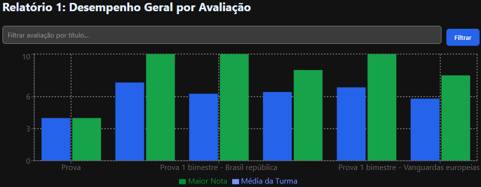
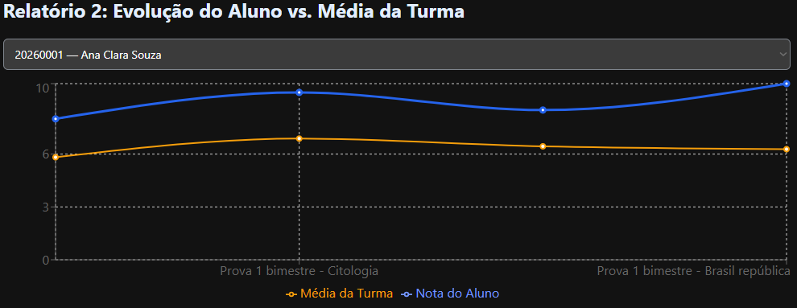
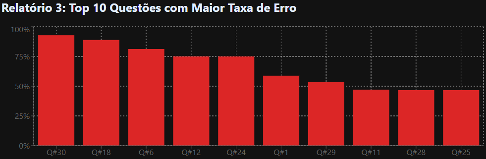
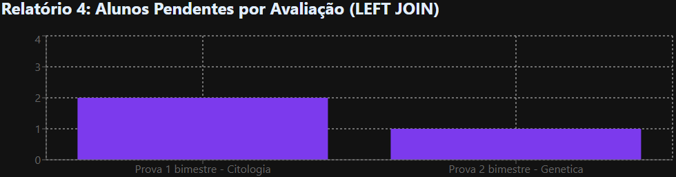

# 🖥️ Projeto-DBI__Sistema_Avaliacoes
> Projeto de Banco de Dados I - Sistema de avaliações (PostgreSQL | Back-End - Java | Sem JPA/Hibernate)

**MEMBROS:**
* André Felipe Ijiri Ribeiro;
* Marcela de Oliveira Dorigao;

**DESCRIÇÃO:** Um sistema web de avaliações, com banco de dados PostgreSQL, em que é possível cadastrar questões, montar avaliações com essas questões, indicar quem deve responder cada avaliação, registrar as respostas e, no fim, ver relatórios com tabelas e gráficos sobre os resultados. O objetivo é praticar, num sistema completo, tudo o que vimos na disciplina: modelagem, mapeamento, normalização, DDL e consultas SQL, ligando o banco a uma aplicação organizada em camadas.

---

## Pré-Requisitos e Execução

### Pré-Requisitos
1. PostgreSQL (versão 14 ou superior) em execução na porta 5432 e pgAdmin 4 (ou psql).
2. Java JDK 17 (ou superior) instalado e configurado no PATH.
3. Node.js 18+ e npm instalados.

### Execução do Projeto

#### Passo 1: Iniciar o Back-end (Terminal CMD 1)
1. Abra o primeiro Prompt de Comando (CMD).
2. Navegue até a pasta do projeto Spring Boot onde está o arquivo pom.xml:
> cd src\backend\SistemaAvaliacao\SistemaAvaliacao
3. Inicie o servidor utilizando o Maven Wrapper:
> mvnw.cmd spring-boot:run
4. Aguarde até aparecer a mensagem Started SistemaAvaliacaoApplication in X.XXX seconds e mantenha este terminal aberto (API ativa em http://localhost:8080).

#### Passo 2: Iniciar o Front-end (Terminal CMD 2)
1. Sem fechar o terminal do back-end, abra um segundo Prompt de Comando (CMD).
2. Navegue até a pasta do front-end React:
> cd src\frontend
3. Instale as dependências do projeto (necessário apenas na primeira execução):
> npm install
4. Inicie o servidor de desenvolvimento do Vite:
> npm run dev
5. Aguarde aparecer Local: http://localhost:5173/ e mantenha este terminal aberto.

#### Passo 3: Acessar no Navegador
Abra `http://localhost:5173` no navegador

---

## 🌳 Natureza do Sistema
> Avaliação de aprendizagem (provas, simulados, quizzes)

Cada `questão` tem um `valor` na `avaliação`. O sistema registra a `nota` obtida em cada `questão`
* Automática nas objetivas;
* Dada pelo professor nas de texto livre;

E calcula a `nota total` de cada aluno.

**Particularidade:** Suporte a questões especializadas em Objetivas (múltipla escolha com exatamente uma alternativa correta garantida por índice único no banco) e Livres (discursivas). Ao submeter uma prova, o sistema corrige automaticamente as questões objetivas comparando a alternativa marcada com o gabarito e calcula a nota parcial; quando o professor atribui a nota das questões discursivas, a nota final do aluno na avaliação é recalculada automaticamente.

---

## Arquitetura e Tecnologias
O sistema segue uma arquitetura desacoplada em camadas, comunicando-se via API REST (JSON):

[React + Vite]  --->  [Controller]  --->  [Model (POJOs/DTOs)]  --->  [DAO (JDBC)]  --->  [PostgreSQL]
 (Porta 5173)          (Porta 8080)          (Transporte)            (SQL + Transações)    (Porta 5432)

* **Banco de Dados:** PostgreSQL (esquema normalizado na 3ª Forma Normal — 3FN).
* **Back-end:** Java 17+, Spring Boot Web, Spring JDBC (JdbcTemplate) sem uso de ORM/JPA.
* **Front-end:** React, Vite, Axios (consumo da API REST) e Recharts (visualização gráfica dos relatórios).

---

## Requisitos Funcionais Implementados
* **RF1 —** Cadastro de Questões: Permite registrar questões objetivas (com múltiplas alternativas e marcação da correta) ou discursivas (texto livre) de forma transacional.
* **RF2 —** Cadastro de Avaliações: Permite ao professor criar avaliações com título, descrição, data e horário de início e término.
* **RF3 —** Composição de Avaliações: Permite selecionar questões do banco e definir a pontuação individual de cada questão na avaliação.
* **RF4 —** Designação de Alunos: Permite vincular os alunos habilitados a realizar cada avaliação.
* **RF5 —** Realização de Avaliações: Permite ao aluno visualizar suas avaliações pendentes, responder às questões e receber correção imediata dos itens objetivos.
* **RF6 —** Correção Discursiva e Nota Final: Permite ao professor visualizar respostas discursivas pendentes, atribuir notas respeitando o valor máximo da questão e recalcular automaticamente a nota final do aluno.
* **RF7 —** Relatórios Analíticos: Apresenta quatro consultas gerenciais combinando tabelas e gráficos interativos.

---

## 📝 Relatórios

| Recurso SQL Exigido | Onde Está Implementado |
| :--- | :--- |
| **Junção interna (JOIN)** | Relatórios 1, 2, 3 e 4 (avaliacao, professor, faz, aluno, questao, compoe, responde) |
| **Junção externa (LEFT JOIN)** | Relatório 1 (avaliacao $\rightarrow$ faz) e Relatório 4 (faz $\rightarrow$ responde para listar quem ainda não respondeu) |
| **Agregação (COUNT, AVG, SUM, GROUP BY, HAVING)** | Relatórios 1, 3 e 4 (SUM(valor), AVG(nota_final), COUNT, GROUP BY, HAVING) |
| **Subconsulta** | Relatório 1 (soma do valor total da prova) e Relatório 2 (subconsulta correlacionada para média da turma) |
| **Ordenação e ranking (ORDER BY, FETCH FIRST, RANK())** | Relatório 3 (RANK() OVER (...), ORDER BY percentual_erro DESC, FETCH FIRST 10 ROWS ONLY) |
| **Filtros diversos (BETWEEN, ILIKE, IN)** | Relatório 1 (BETWEEN em datas e ILIKE no título) e Relatório 3 (IN por lista de avaliações) |

### Relatório 1: Desempenho Geral por Avaliação
* **Objetivo:** Apresentar um panorama consolidado de cada avaliação aplicada, exibindo o professor responsável, a taxa de adesão dos alunos, a média da turma, a menor e a maior nota, com filtro dinâmico por título ou período.
* **Recursos SQL utilizados:** JOIN, LEFT JOIN, subconsulta correlacionada, funções de agregação (COUNT, AVG, MIN, MAX), COALESCE, ROUND, GROUP BY, HAVING e filtro textual com ILIKE.
* **Print da Interface:**

### Relatório 2: Evolução Individual do Aluno vs. Média da Turma
* **Objetivo:** Acompanhar o histórico de notas de um aluno específico ao longo das avaliações realizadas e compará-lo diretamente com a média da turma em cada prova.
* **Recursos SQL utilizados:** JOIN entre três tabelas (faz, avaliacao, aluno), subconsulta escalar correlacionada na projeção (SELECT), ROUND e ordenação cronológica.
* **Print da Interface:**

### Relatório 3: Top 10 Questões com Maior Taxa de Erro
* **Objetivo:** Identificar as questões em que os alunos apresentaram maior dificuldade (nota obtida inferior ao valor total da questão), auxiliando o corpo docente na revisão de conteúdos.
* **Recursos SQL utilizados:** JOIN, LEFT JOIN (especialização objetiva), expressão condicional CASE WHEN, COUNT, ROUND, GROUP BY, HAVING, ORDER BY e LIMIT.
* **Print da Interface:**

### Relatório 4: Alunos Pendentes por Avaliação
* **Objetivo:** Listar todos os alunos designados para uma avaliação (faz) que ainda não enviaram nenhuma resposta (responde), permitindo o controle de pendências e segunda chamada.
* **Recursos SQL utilizados:** JOIN e LEFT JOIN com filtragem de ausência de correspondência (WHERE r.matricula IS NULL).
* **Print da Interface:**

---